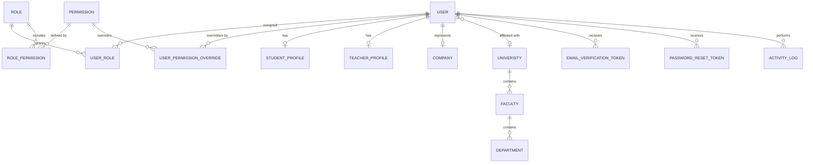
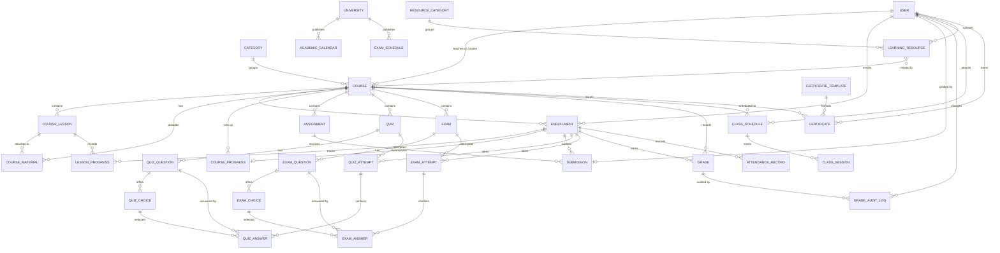
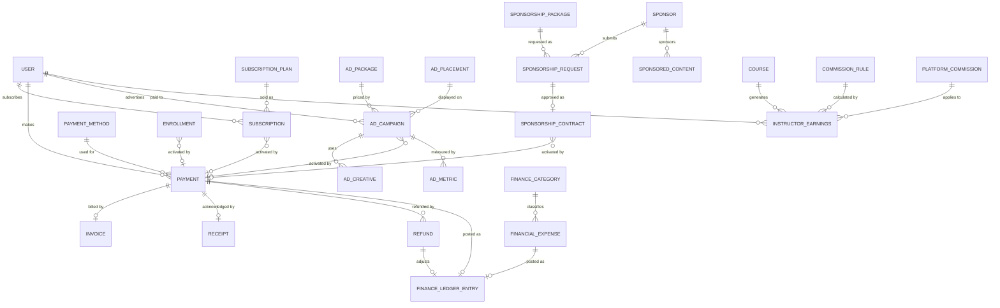

# Database Design & Entity Relationship Diagram

This document describes the target normalized MySQL/MariaDB schema for the All-in-One Student Portal. It extends the existing Smart Learning Platform schema; existing tables and data are preserved. Tables marked **existing** are implemented today, while tables marked **target** are added by the phased plan in `docs/SCOPE.md`.

The schema uses a custom user model (`accounts.User`), explicit roles and permissions, optional profile tables, and a finance ledger so academic, career, community, advertising, sponsorship, and payment data remain auditable.

## Identity, access, and organization



## Academic and learning



## Communication, opportunities, community, and support

```mermaid
erDiagram
    USER ||--o{ ANNOUNCEMENT : "creates"
    COURSE ||--o{ ANNOUNCEMENT : "targets"
    UNIVERSITY ||--o{ ANNOUNCEMENT : "publishes"
    USER ||--o{ NOTIFICATION : "receives"
    USER ||--o{ ANNOUNCEMENT : "audience"

    USER ||--o{ AI_CONVERSATION : "starts"
    COURSE ||--o{ AI_CONVERSATION : "context"
    COURSE_LESSON ||--o{ AI_CONVERSATION : "context"
    AI_CONVERSATION ||--o{ AI_MESSAGE : "contains"

    USER ||--o| COMPANY : "owns"
    COMPANY ||--o{ JOB : "posts"
    JOB_POSTING_PACKAGE ||--o{ JOB : "purchased for"
    USER ||--o{ CV_DOCUMENT : "uploads"
    USER ||--o{ JOB_APPLICATION : "submits"
    JOB ||--o{ JOB_APPLICATION : "receives"
    CV_DOCUMENT ||--o{ JOB_APPLICATION : "supports"

    SCHOLARSHIP_CATEGORY ||--o{ SCHOLARSHIP : "groups"
    UNIVERSITY ||--o{ SCHOLARSHIP : "publishes"
    USER ||--o{ SCHOLARSHIP_APPLICATION : "submits"
    SCHOLARSHIP ||--o{ SCHOLARSHIP_APPLICATION : "receives"

    USER ||--o{ FORUM_POST : "writes"
    FORUM_POST ||--o{ FORUM_COMMENT : "discussed by"
    USER ||--o{ FORUM_COMMENT : "writes"
    USER ||--o{ FORUM_LIKE : "likes"
    FORUM_POST ||--o{ FORUM_LIKE : "receive"
    USER ||--o{ FORUM_SAVE : "saves"
    FORUM_POST ||--o{ FORUM_SAVE : "receive"
    USER ||--o{ FORUM_REPORT : "reports"
    FORUM_POST ||--o{ FORUM_REPORT : "flagged"

    EVENT_CATEGORY ||--o{ EVENT : "groups"
    USER ||--o{ EVENT : "organizes"
    EVENT ||--o{ EVENT_REGISTRATION : "receives"
    USER ||--o{ EVENT_REGISTRATION : "registers"

    FAQ_CATEGORY ||--o{ FAQ : "groups"
    USER ||--o{ SUPPORT_TICKET : "opens"
    SUPPORT_TICKET ||--o{ SUPPORT_TICKET_MESSAGE : "contains"
    USER ||--o{ SUPPORT_TICKET_MESSAGE : "writes"
    USER ||--o{ FEEDBACK : "submits"
```



## Memberships, advertising, sponsorships, payments, and finance



## Table inventory

| Area | Target tables | Status and intent |
| --- | --- | --- |
| Identity | `accounts_user`, `accounts_studentprofile`, `accounts_teacherprofile` | **Existing.** Email login; one user table with optional role-specific profiles. |
| Access control | `core_role`, `core_permission`, `core_rolepermission`, `core_userrole`, `core_userpermissionoverride` | **Implemented.** Named roles, permission codes, role grants, user-role assignments, and overrides. |
| Organization | `core_university`, `core_faculty`, `core_department` | **Implemented.** University-scoped administration and official records. |
| Auth lifecycle | `core_emailverificationtoken`, `core_passwordresettoken` | **Implemented.** Token-based verification and reset with expiry and used-at tracking. |
| Audit | `analytics_activitylog`, `analytics_gradeauditlog` | **Existing/implemented.** User actions, attendance-write events, and immutable official grade-change history. |
| Catalog | `courses_category`, `courses_course` | **Existing.** Courses belong to a category and an owner/instructor. |
| Content | `learning_lesson`, `learning_material`, `learning_resourcetag`, `learning_learningresource`, `learning_resourcecategory` | **Existing/target.** Ordered lessons, files, external links, and searchable free/premium resources. |
| Enrollment | `courses_enrollment`, `learning_lessonprogress`, `learning_courseprogress` | **Existing.** Unique enrollment and progress records. |
| Assignments | `assessments_assignment`, `assessments_submission` | **Existing.** One submission per student/assignment with status, score, feedback, and grader. |
| Quizzes | `assessments_quiz`, `assessments_question`, `assessments_choice`, `assessments_quizattempt`, `assessments_quizanswer` | **Existing.** Attempts, answers, time limits, and release rules. |
| Exams | `assessments_exam`, `assessments_examquestion`, `assessments_examchoice`, `assessments_examattempt`, `assessments_examanswer` | **Existing.** Midterm settings and attempts separate from quizzes. |
| Grades | `assessments_grade`, `analytics_gradeauditlog`, `learning_attendancerecord` | **Existing/implemented.** Weighted gradebook, audit trail, and permission-gated attendance records. |
| Scheduling | `academic_classschedule`, `academic_classsession`, `academic_academiccalendar`, `academic_examschedule` | **Implemented.** Timetable, sessions, academic calendar, and examination schedule. |
| Certificates | `certificates_certificatetemplate`, `certificates_certificate` | **Existing.** Unique certificate ID and verification code; unique `(student, course)`. |
| Communication | `notifications_announcement`, `notifications_notification` | **Existing.** Audience-targeted announcements and per-user notifications. |
| AI | `ai_assistant_conversation`, `ai_assistant_message` | **Existing.** Course/lesson scoped study assistant history. |
| Careers | `careers_companyprofile`, `careers_jobpostingpackage`, `careers_job`, `careers_cvdocument`, `careers_jobapplication` | **Implemented.** Company profiles, paid job packages, job postings, applications, and CV documents. |
| Scholarships | `scholarships_scholarshipcategory`, `scholarships_scholarship`, `scholarships_scholarshipapplication` | **Implemented.** Listings, eligibility, categories, deadlines, and applications. |
| Community | `community_forumcategory`, `community_forumpost`, `community_forumcomment`, `community_forumlike`, `community_forumsave`, `community_forumreport` | **Implemented.** Discussion, engagement, and moderation records. |
| Events | `events_eventcategory`, `events_event`, `events_eventregistration` | **Implemented.** Workshops, seminars, competitions, and registrations. |
| Support | `support_faqcategory`, `support_faq`, `support_supportticket`, `support_ticketmessage`, `support_feedback` | **Implemented.** Help center, tickets, complaints, and feedback. |
| Subscriptions | `subscriptions_plan`, `subscriptions_subscription`, `subscriptions_entitlement` | **Target/extends existing.** FREE, PRO, Premium plans, active periods, and entitlement evaluation. |
| Payments | `finance_paymentmethod`, `finance_payment`, `finance_invoice`, `finance_receipt`, `finance_refund` | **Existing/target.** Manual and gateway payments, references, verification, invoices, receipts, and refunds. |
| Advertising | `advertising_package`, `advertising_placement`, `advertising_campaign`, `advertising_creative`, `advertising_metric` | **Target.** Paid campaigns, approvals, placements, creatives, and view/click metrics. |
| Sponsorships | `sponsorship_sponsor`, `sponsorship_package`, `sponsorship_request`, `sponsorship_contract`, `sponsorship_content` | **Target.** Sponsor profiles, packages, requests, contracts, revenue, and sponsored content. |
| Instructor finance | `finance_instructorearnings`, `finance_commissionrule`, `finance_platformcommission` | **Target/extends existing.** Course revenue share using the 15% default commission. |
| Finance ledger | `finance_financecategory`, `finance_financialexpense`, `finance_ledgerentry` | **Target.** Single source of truth for revenue, refunds, expenses, and net income reports. |

## Integrity and security rules

- The custom user model is installed before the first migration (`AUTH_USER_MODEL = "accounts.User"`).
- Email addresses are unique and normalized to lowercase on save.
- Password hashes are managed by Django; raw passwords and raw bank-card data are never stored.
- Foreign keys use explicit deletion behavior:
  - `PROTECT` for course owners, roles, payment methods with history, and finance ledger categories.
  - `SET_NULL` for optional references such as graders, uploaders, templates, universities, and approved_by users.
  - `CASCADE` only for dependent content such as lessons, messages, answers, and registrations.
- Unique constraints prevent duplicate role assignments, permissions, enrollments, progress records, submissions, attempts, certificates, applications, registrations, invoices, receipts, and payment reference numbers.
- At most one active subscription per user per billing cycle is enforced with a conditional unique constraint on active subscriptions.
- Membership entitlements are computed from an active subscription between `starts_at` and `ends_at`; a role flag alone cannot grant premium access.
- A payment becomes successful only after admin verification or a verified gateway webhook. All state changes are recorded.
- Refunds create a finance ledger adjustment and cannot silently overwrite original revenue.
- Official grades and attendance can only be written by authorized lecturer/university/admin accounts; every change creates a `GradeAuditLog` or equivalent attendance audit entry.
- Correct answers live in `Choice.is_correct`, `Question.correct_answer`, `ExamChoice.is_correct`, and `ExamQuestion.correct_answer`. Student-facing API serializers must exclude them until an attempt is submitted.
- Quiz and exam availability is enforced server-side with opening/closing timestamps, attempt limits, and duration rules. Frontend timers are advisory only.
- Ads are clearly labeled and cannot be placed inside quiz/exam flows. Only approved, active campaigns within package limits are displayed.
- Ad metrics are recorded per placement/day; dashboards aggregate from these records rather than mutable counters.
- Commission defaults to 15% and is stored per rule/period so historical earnings remain reproducible.
- Support tickets, job applications, scholarship applications, ad campaigns, and refunds have explicit status workflows with timestamps and actor tracking.
- Certificate records expose a public verification code separate from the human-readable certificate ID.
- Every privileged action writes an `ActivityLog` entry with actor, action, IP address, user agent, and JSON metadata where applicable.

## Payment status workflow

```text
PENDING -> SUCCESSFUL -> REFUNDED
PENDING -> FAILED
PENDING -> CANCELLED
```

- `PENDING`: payment submitted but not verified.
- `SUCCESSFUL`: verified by admin or gateway webhook; entitlements and purchases activate here.
- `FAILED`: verification failed; no entitlement is created.
- `CANCELLED`: user or admin cancelled before verification.
- `REFUNDED`: successful payment reversed through `Refund` and a ledger adjustment.

## Subscription model

| Plan | Price | Billing | Key entitlements |
| --- | --- | --- | --- |
| FREE | $0 | Ongoing | Public resources, schedule, listings, community, basic dashboard. |
| STUDENT_PRO | $2/month or yearly equivalent | Monthly/yearly | PRO resources, ad-free access, practice tests, CV templates, progress analytics. |
| STUDENT_PREMIUM | $4/month or yearly equivalent | Monthly/yearly | Everything in PRO plus premium courses, advanced resources, career materials, exclusive workshops, priority support. |

Plan prices are configuration data in `subscriptions_plan`; entitlement checks use plan codes, not display names.

## Commission model

- Default platform commission: `15%`.
- Instructor earnings: `net_course_revenue - platform_commission`, where commission is calculated from the active `CommissionRule`.
- Historical `PlatformCommission` rows preserve the rule, rate, and amount applied to each earning.
- Super Admin can change the default rate, but existing earnings are not recalculated.

## File storage

- Uploaded paths are relative to `MEDIA_ROOT` (`media/`) and served only in development through `MEDIA_URL`.
- Existing dedicated directories: avatars, course thumbnails, lesson videos, learning materials, submissions, certificate templates, and generated certificates.
- Target dedicated directories: `resources/`, `cvs/`, `company_logos/`, `job_attachments/`, `scholarship_attachments/`, `event_covers/`, `ad_creatives/`, `sponsor_logos/`, `sponsored_content/`, `invoices/`, `receipts/`, and `support_attachments/`.
- Uploads are validated by extension, MIME type where available, and maximum size. Public downloads use signed or role-checked views for private materials.
- Production deployments must serve media through the web server or an object store, not Django.
